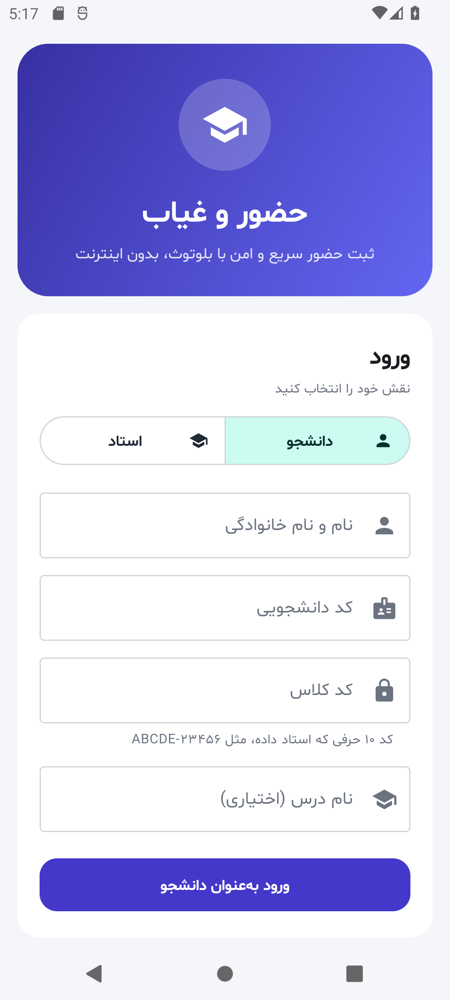
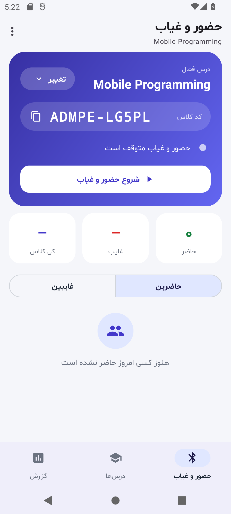
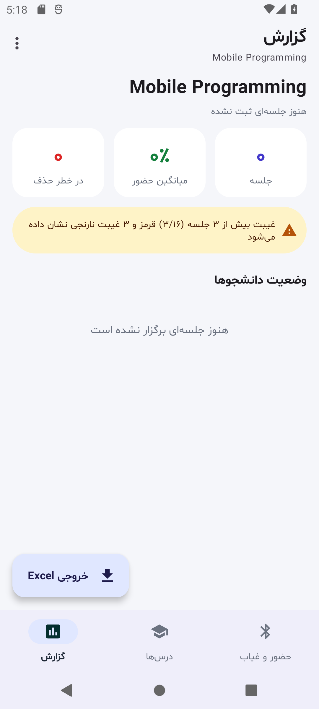
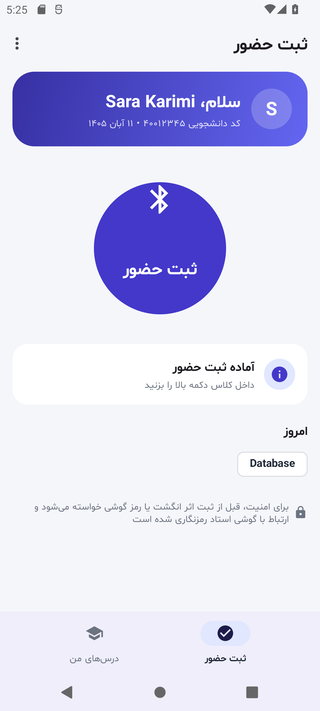
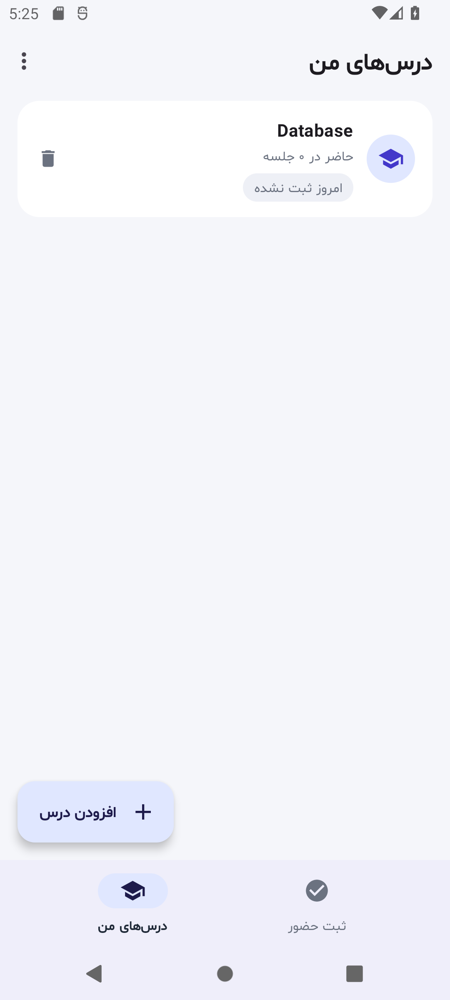

# Presence — حضور و غیاب بدون اینترنت

اپلیکیشن اندرویدی برای حضور و غیاب دانشجوها در کلاس با **بلوتوث کم‌مصرف (BLE)** و بدون نیاز به اینترنت یا سرور.
گوشی استاد سیگنال کلاس را پخش می‌کند و گوشی دانشجو داخل کلاس آن را پیدا می‌کند و حضور را ثبت می‌کند.

گزارش کامل پروژه (معماری، پروتکل، امنیت، نمودارها و آزمون‌ها): [docs/report.md](docs/report.md)

## امکانات

**استاد**
- چند درس، هر درس با **کد کلاس** جداگانه
- شروع/توقف حضور و غیاب با یک دکمه
- لیست **حاضرین** و **غایبین** امروز و خلاصه «حاضر: ۲۵ از ۳۰»
- **وارد کردن لیست کلاس** از فایل CSV (ذخیره‌شده از Excel)
- ثبت دستی حضور و حذف حضور اشتباه (با نگه داشتن انگشت روی هر نفر)
- **خروجی Excel** (`.xlsx`) به‌صورت جدول دانشجو × جلسه، همراه با تعداد غیبت و هشدار غیبت بیش از ۳/۱۶
- تاریخ شمسی
- **ادامه حضور و غیاب در پس‌زمینه** (Foreground Service): با قفل شدن گوشی یا رفتن به برنامه دیگر قطع نمی‌شود؛ اعلان آن تعداد حاضرین امروز و دکمه «توقف» دارد
- **پشتیبان‌گیری و بازیابی** همه درس‌ها، لیست‌ها و حضورها در یک فایل JSON (برای عوض کردن گوشی)؛ کد کلاس درس‌ها حفظ می‌شود

**دانشجو**
- اضافه کردن درس‌ها با کد کلاسی که استاد می‌دهد
- ثبت حضور با یک دکمه؛ برنامه خودش تشخیص می‌دهد گوشی استاد مال کدام درس است
- تأیید هویت با اثر انگشت یا قفل صفحه قبل از ثبت
- وضعیت امروز و تعداد جلسات حاضر برای هر درس

**امنیت**
- احراز هویت دوطرفه با **HMAC-SHA256** و چالش یک‌بارمصرف (nonce)
- رد پیام تکراری (replay)، کد کلاس اشتباه و گوشی استاد جعلی
- هر دانشجو و هر گوشی فقط یک بار در روز برای هر درس

## روش استفاده

1. **استاد:** در صفحه ورود «استاد» را انتخاب کند و نام خود و نام اولین درس را وارد کند.
   کد کلاس (مثل `ABCDE-23456`) در تب «حضور و غیاب» نمایش داده می‌شود؛ آن را یک بار به دانشجوها بدهد.
2. **دانشجو:** نام، کد دانشجویی و کد کلاس را وارد کند. درس‌های دیگر را بعداً با «افزودن درس» اضافه کند.
3. سر کلاس، استاد «شروع حضور و غیاب» را می‌زند و دانشجوها «ثبت حضور» را.
4. آخر ترم، استاد از تب «گزارش» «خروجی Excel» را می‌گیرد.
5. گاه‌به‌گاه از منوی سه‌نقطه «پشتیبان‌گیری از اطلاعات» را بزند. روی گوشی جدید بعد از ورود به‌عنوان استاد، «بازیابی از پشتیبان» همه‌چیز را برمی‌گرداند.
   فایل پشتیبان کد کلاس درس‌ها را دارد؛ آن را به کسی ندهید.

### فرمت فایل لیست کلاس

یک فایل CSV با دو ستون کد دانشجویی و نام (به هر ترتیبی). سطر عنوان و ستون «ردیف» خودکار نادیده گرفته می‌شوند.
در Excel: **File → Save As → CSV UTF-8**. فایل CSV معمولی Excel فارسی (کدگذاری 1256) هم خوانده می‌شود.

```
ردیف,کد دانشجویی,نام و نام خانوادگی
1,40012345,علی رضایی
2,40012346,مریم احمدی
```

## ساخت پروژه

- Android Studio (یا Gradle) با **JDK 17 یا 21** — Gradle 8.11 با JDK 25 اجرا نمی‌شود
- حداقل اندروید ۱۰ (API 29)

```bash
./gradlew assembleDebug          # فایل نصبی: app/build/outputs/apk/debug/app-debug.apk
./gradlew testDebugUnitTest      # تست‌های واحد و تست Migration دیتابیس
```

برای آزمایش واقعی دو گوشی لازم است (یکی استاد، یکی دانشجو)؛ شبیه‌ساز اندروید بلوتوث ندارد.

## رابط کاربری

| ورود | استاد: حضور و غیاب | استاد: گزارش | دانشجو: ثبت حضور | دانشجو: درس‌های من |
|---|---|---|---|---|
|  |  |  |  |  |

- طراحی Material 3 با رنگ‌بندی یکدست، کارت‌ها و آیکون‌ها؛ فونت فارسی **شبنم** با اعداد فارسی
- برنامه همیشه فارسی و راست‌به‌چپ است، حتی اگر زبان گوشی انگلیسی باشد
- **ناوبری پایین**
  - استاد: «حضور و غیاب» (شروع/توقف، حاضرین و غایبین امروز)، «درس‌ها» (کد کلاس، لیست کلاس)، «گزارش» (آمار و خروجی Excel)
  - دانشجو: «ثبت حضور» (دکمه بزرگ با وضعیت لحظه‌ای)، «درس‌های من»
- منوی سه‌نقطه بالا: پشتیبان‌گیری و بازیابی (استاد)، درباره برنامه، خروج و حذف اطلاعات
- تا وقتی حضور و غیاب روشن است صفحه گوشی استاد خاموش نمی‌شود و با عوض کردن تب قطع نمی‌شود

## ساختار کد

| بخش | فایل‌ها |
|---|---|
| قاب و ناوبری | `MainActivity` (نوار بالا، ناوبری پایین، زبان فارسی) |
| صفحه‌های استاد | `TeacherSessionFragment`، `TeacherCoursesFragment`، `TeacherReportFragment`، `TeacherViewModel` |
| صفحه‌های دانشجو | `StudentCheckInFragment`، `StudentCoursesFragment`، `StudentViewModel`، `LoginFragment` |
| بلوتوث | `AttendanceServer` (استاد)، `AttendanceService` (سرویس پیش‌زمینه استاد)، `AttendanceClient` (دانشجو) |
| پروتکل و امنیت | `BleConstants`، `AttendanceCrypto`، `AttendanceVerifier`، `AttendancePayload` |
| آمار | `AttendanceStats` |
| دیتابیس (Room) | `MainDatabase`، `Logingdata` (Entityها)، `*Dao`، `*Repository` |
| ورودی/خروجی | `RosterParser` (CSV)، `AttendanceExporter` و `XlsxWriter` (Excel)، `AttendanceBackup` و `BackupRepository` (پشتیبان JSON) |
| ابزارها | `PersianDate` (تاریخ شمسی و اعداد فارسی)، `TimeUtils`، `InputDialog` |
| تست‌ها | `app/src/test/...` |

## منابع و مجوزها

- فونت [شبنم](https://github.com/rastikerdar/shabnam-font) اثر صابر راستی‌کردار — SIL Open Font License 1.1
- آیکون‌ها: Material Icons گوگل — Apache License 2.0
