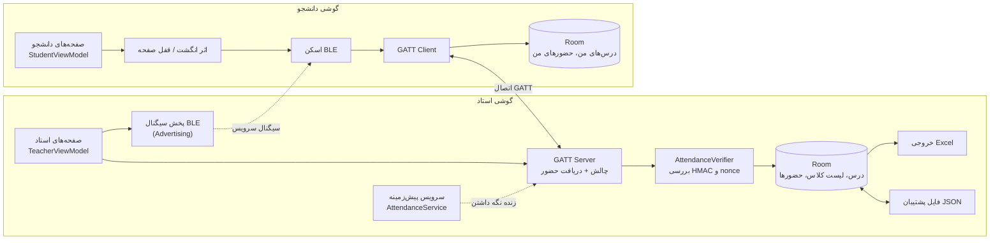
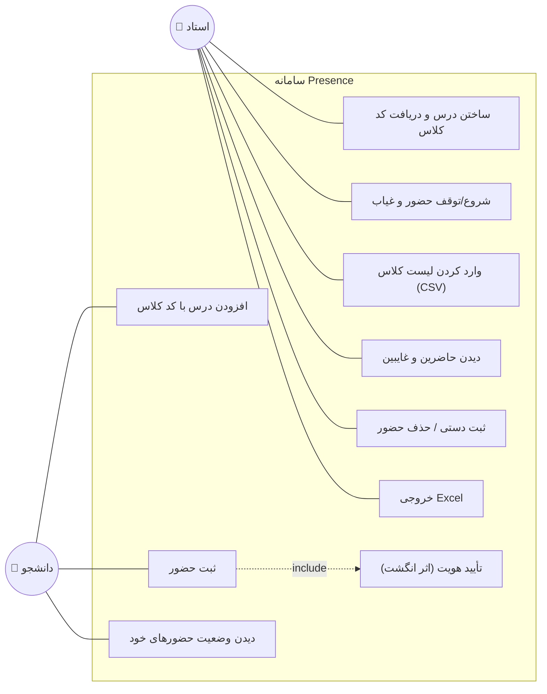
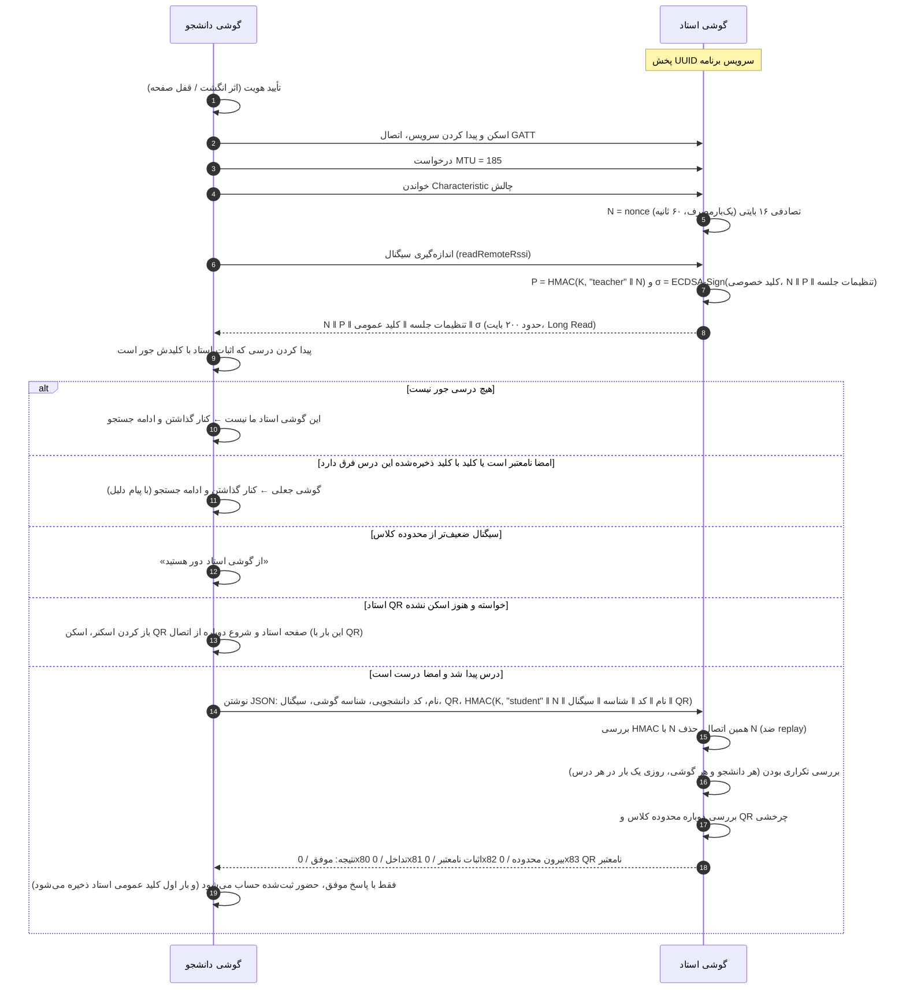
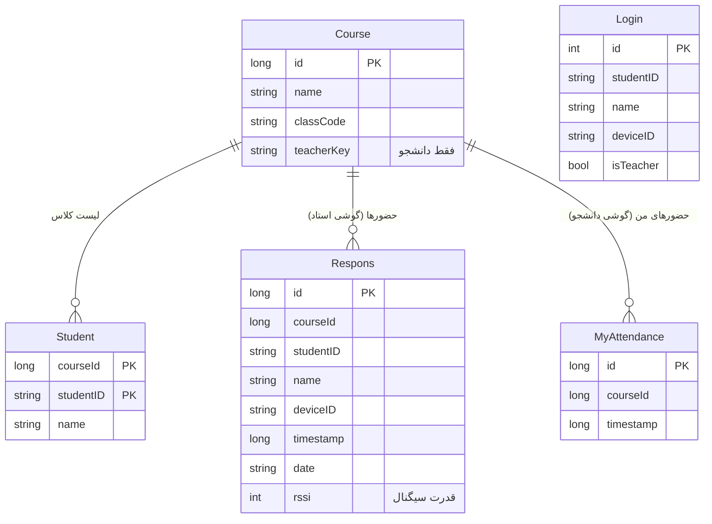

# گزارش پروژه: سامانه حضور و غیاب بدون اینترنت با بلوتوث کم‌مصرف

## ۱. بیان مسئله

حضور و غیاب کاغذی یا شفاهی وقت کلاس را می‌گیرد و جلوی «حاضر زدن به‌جای دیگری» را نمی‌گیرد.
سامانه‌های آنلاین هم به اینترنت و سرور نیاز دارند که در همه کلاس‌ها در دسترس نیست.

هدف این پروژه سامانه‌ای است که:
- **کاملاً بدون اینترنت** کار کند (فقط گوشی استاد و گوشی دانشجوها)؛
- **حضور فیزیکی** دانشجو در کلاس را بسنجد؛
- جلوی **تقلب‌های رایج** را بگیرد؛
- خروجی قابل استفاده برای استاد (Excel) بدهد.

## ۲. انتخاب فناوری: مقایسه روش‌های بدون اینترنت

| روش | نیاز به سخت‌افزار/سرویس | سنجش حضور فیزیکی | تجربه کاربر | محدودیت اصلی |
|---|---|---|---|---|
| **بلوتوث کم‌مصرف (BLE)** ✅ | همه گوشی‌های اندروید ۵ به بعد | برد ۱۰ تا ۳۰ متر ≈ اندازه کلاس | یک دکمه، بدون جفت‌سازی | محدودیت اتصال هم‌زمان GATT |
| Wi-Fi Direct | پشتیبانی گوشی؛ تأیید دستی هر اتصال | برد زیاد (تا ~۱۰۰ متر، بیرون کلاس) | کند و نیازمند تأیید | تجربه کاربری ضعیف برای ۵۰ نفر |
| Google Nearby Connections | Google Play Services | بله (ترکیب بلوتوث و Wi-Fi) | خوب | وابسته به سرویس گوگل؛ روی همه گوشی‌ها نیست |
| QR کد روی صفحه استاد | دوربین | ضعیف؛ عکس QR را می‌شود برای غایب فرستاد | خوب | کپی‌پذیر (مگر چرخشی و ترکیبی) |
| NFC | NFC روی هر دو گوشی | خیلی قوی (چند سانتی‌متر) | باید گوشی‌ها را به هم زد؛ صف طولانی | خیلی از گوشی‌ها NFC ندارند |
| کاغذی | — | ضعیف | کند | امضا به‌جای دیگری |

**نتیجه:** BLE تنها روشی است که هم روی تقریباً همه گوشی‌ها هست، هم به سرویس بیرونی وابسته نیست، هم بردش با اندازه کلاس جور است و هم بدون جفت‌سازی کار می‌کند.
ضعف BLE (قابل جعل بودن سیگنال) با پروتکل چالش-پاسخ رمزنگاری‌شده (بخش ۵) جبران شده است.
QR چرخشی می‌تواند در آینده به‌عنوان عامل دوم اضافه شود.

## ۳. معماری

- **زبان و کتابخانه‌ها:** Kotlin، Android Jetpack (Room، LiveData، Coroutines، Biometric)، Material Components
- **الگوی معماری:** MVVM — صفحه (Fragment) ← ViewModel ← Repository ← DAO ← SQLite.
  بخش بلوتوث در کلاس‌های `AttendanceServer` و `AttendanceClient` جداست. سرور استاد در کل برنامه یک نمونه دارد و
  یک **سرویس پیش‌زمینه** (Foreground Service از نوع connectedDevice) تا وقتی حضور و غیاب روشن است برنامه را زنده نگه می‌دارد؛
  پس با عوض شدن صفحه، چرخش گوشی، قفل شدن صفحه یا رفتن به برنامه دیگر قطع نمی‌شود. اعلان این سرویس تعداد حاضرین امروز و دکمه «توقف» دارد.
- **رابط کاربری:** Material 3، ناوبری پایین (استاد: حضور و غیاب / درس‌ها / گزارش؛ دانشجو: ثبت حضور / درس‌های من)، فونت فارسی شبنم، راست‌به‌چپ کامل
- **بدون کتابخانه بیرونی** برای رمزنگاری (javax.crypto)، تاریخ شمسی و ساخت فایل Excel

## ۴. نمودار موارد کاربرد (Use Case)

## ۵. پروتکل ثبت حضور

### ۵.۱ کد کلاس

برای هر درس، گوشی استاد یک **کد کلاس** ۱۰ نویسه‌ای تصادفی (`SecureRandom`) می‌سازد، مثل `ABCDE-23456`.
الفبای کد ۳۲ نویسه است (بدون O/0 و I/1 که با هم اشتباه می‌شوند)، پس کد حدود **۵۰ بیت** آنتروپی دارد.
استاد کد را یک بار (مثلاً جلسه اول) به دانشجوها می‌دهد. کلید HMAC از روی کد ساخته می‌شود: `K = SHA-256(classCode)`.

### ۵.۲ امضای دیجیتال گوشی استاد

کد کلاس **رمز مشترک** است و همه دانشجوهای کلاس آن را دارند؛ پس اثبات HMAC استاد را هر هم‌کلاسی هم می‌تواند بسازد
و با برنامه دست‌کاری‌شده خودش را جای گوشی استاد جا بزند (حضورها را بگیرد و به استاد نرساند).
برای همین گوشی استاد یک **جفت کلید ECDSA روی منحنی P-256** (معادل امنیتی ۱۲۸ بیت) دارد و هر چالش را امضا می‌کند:

- **کلید خصوصی** فقط در گوشی استاد است و هیچ‌وقت ارسال نمی‌شود.
- **کلید عمومی** داخل هر چالش فرستاده می‌شود. گوشی دانشجو آن را در **اولین ثبت حضور موفق** هر درس ذخیره می‌کند
  (روش **TOFU** یا «اعتماد در اولین استفاده»، همان روشی که SSH برای کلید سرورها به کار می‌برد).
- از آن به بعد دانشجو فقط به گوشی‌ای داده می‌فرستد که هم HMAC درست دارد و هم امضایش با **همان کلید ذخیره‌شده** درست است.
- استاد در پنجره «نمایش کد» و دانشجو در کارت درس، **اثر انگشت کلید** (۱۶ رقم مبنای ۱۶ از SHA-256 کلید عمومی، مثل `4F2A 91C0 7B3E D215`)
  را می‌بینند و می‌توانند سر کلاس مقایسه کنند؛ مثل «شماره امنیتی» در پیام‌رسان Signal.

چرا Ed25519 نه؟ پشتیبانی Ed25519 در اندروید از نسخه ۱۳ است و حداقل نسخه برنامه اندروید ۱۰؛ ECDSA P-256 در همه نسخه‌ها هست.
چرا Android Keystore نه؟ کلید Keystore از گوشی خارج نمی‌شود و با «پشتیبان‌گیری» به گوشی جدید استاد منتقل نمی‌شد؛
کلید در حافظه خصوصی برنامه نگه داشته می‌شود و فایل پشتیبان آن را دارد (پس فایل پشتیبان باید محرمانه بماند).

### ۵.۳ محدوده کلاس با قدرت سیگنال

برد بلوتوث کم‌مصرف تا چند ده متر است؛ پس دانشجوی پشت در یا راهروی کلاس هم ممکن است سیگنال بگیرد.
استاد در کارت حضور و غیاب «محدوده کلاس» را انتخاب می‌کند:

| محدوده | کمترین RSSI | فاصله تقریبی |
|---|---|---|
| بدون محدودیت (پیش‌فرض) | — | تمام برد بلوتوث |
| کلاس معمولی | ‎-82 dBm | حدود ۱۰ متر |
| کلاس کوچک | ‎-72 dBm | حدود ۵ متر |

- محدوده داخل چالش است و **امضای استاد** آن را هم در بر می‌گیرد؛ پس گوشی جعلی نمی‌تواند آن را کم کند.
- گوشی دانشجو سیگنال را دو بار اندازه می‌گیرد (هنگام اسکن و با `readRemoteRssi` بعد از اتصال) و قوی‌تر را حساب می‌کند تا نوسان سیگنال کمتر باعث رد اشتباه شود.
- عدد سیگنال داخل HMAC دانشجوست و **گوشی استاد هم دوباره بررسی می‌کند** (کد خطای `0x82`)، و برای هر حضور در دیتابیس می‌ماند
  تا استاد در لیست حاضرین «سیگنال قوی / متوسط / ضعیف» ببیند.
- محدودیت: RSSI به گوشی، بدن، دیوار و جهت آنتن بستگی دارد؛ عددها تقریبی‌اند و باید با آزمون میدانی (بخش ۹.۲) تنظیم شوند.
  برنامه دست‌کاری‌شده هم می‌تواند عدد سیگنال را دروغ بگوید (اثبات HMAC فقط تغییر در مسیر را جلوگیری می‌کند)؛ برای همین QR چرخشی هم هست.

### ۵.۴ QR چرخشی (عامل دوم)

اگر استاد در «تنظیمات جلسه» QR را روشن کند، بلوتوث به‌تنهایی کافی نیست:

1. گوشی استاد با دکمه «نمایش QR به کلاس» یک QR نشان می‌دهد که **هر ۱۰ ثانیه** عوض می‌شود (با نوار شمارش معکوس و روشنایی کامل صفحه).
2. دانشجو «ثبت حضور» را می‌زند؛ چالش امضاشده استاد پرچم «QR لازم است» دارد، پس اسکنر دوربین باز می‌شود.
3. بعد از اسکن، برنامه دوباره وصل می‌شود و متن QR را داخل پیام امضاشده (HMAC) می‌فرستد. گوشی استاد بررسی می‌کند (کد خطای `0x83`).

- محتوای QR: `PRESENCE-QR:دوره:توکن`؛ دوره = زمان تقسیم بر ۱۰ ثانیه و توکن = HMAC-SHA256 دوره با کلیدی که از
  **کلید خصوصی امضای استاد** و کد کلاس ساخته می‌شود. پس دانشجو با داشتن کد کلاس هم نمی‌تواند QR بسازد.
- QR تا ۳ دوره (حدود ۳۰ ثانیه) پذیرفته می‌شود چون اسکن و اتصال دوباره چند ثانیه وقت می‌برد؛ QR آینده پذیرفته نمی‌شود.
- ساخت QR با ZXing و اسکن با zxing-android-embedded، **بدون اینترنت و بدون سرویس‌های گوگل**.
- دانشجوی بیرون کلاس صفحه استاد را نمی‌بیند؛ عکس QR که دوستش بفرستد حداکثر ۳۰ ثانیه به کار می‌آید و هم‌زمان باید
  سیگنال بلوتوث گوشی استاد را هم بگیرد.

### ۵.۵ نمودار توالی

### ۵.۶ جزئیات پیاده‌سازی

| مورد | مقدار |
|---|---|
| UUID سرویس | `6f1c2a4e-8b3d-4c7a-9e51-2d7f0b9a3c11` (اختصاصی، ۱۲۸ بیتی) |
| Characteristic حضور (نوشتن) | `...3c12` |
| Characteristic چالش (خواندن) | `...3c13` |
| الگوریتم | HMAC-SHA256 کوتاه‌شده به ۱۶ بایت؛ هر بخش با طولش وارد HMAC می‌شود |
| امضای استاد | `SHA256withECDSA` روی P-256؛ کلید عمومی X.509 (۹۱ بایت)، امضای DER (حدود ۷۱ بایت) |
| قالب چالش | `nonce(16) ‖ HMAC(16) ‖ تنظیمات(2) ‖ طول کلید(1) ‖ کلید عمومی ‖ امضا`؛ برای خواندن تکه‌ای همان بایت‌ها نگه داشته می‌شود |
| اعتبار nonce | ۶۰ ثانیه، یک‌بارمصرف، جدا برای هر دستگاه |
| کدهای خطا | `0x80` تداخل (کد دانشجویی یا گوشی با مشخصات دیگر)، `0x81` اثبات نامعتبر، `0x82` بیرون محدوده کلاس، `0x83` QR کهنه یا جعلی |
| داده‌های بزرگ‌تر از MTU | پشتیبانی از Long Read و Prepared/Execute Write در سمت استاد |

## ۶. پایگاه داده

هر گوشی فقط جدول‌های مربوط به نقش خودش را پر می‌کند.
تغییر ساختار بین نسخه‌ها با **Migration** انجام می‌شود تا داده‌ها پاک نشوند (نسخه ۳ ← ۴ ← ۵ ← ۶ ← ۷).

## ۷. تحلیل امنیت و تهدیدها

| تهدید | راه مقابله | وضعیت |
|---|---|---|
| گوشی جعلی (بدون کد کلاس) خودش را استاد معرفی کند و حضورها را بدزدد | استاد باید HMAC با کد کلاس را نشان دهد؛ دانشجو بدون آن داده‌ای نمی‌فرستد | ✅ |
| هم‌کلاسی که کد کلاس را دارد خودش را استاد جا بزند | امضای ECDSA با کلید خصوصی که فقط گوشی استاد دارد، و کلید عمومی ذخیره‌شده در گوشی دانشجو | ✅ بعد از اولین حضور |
| گوشی جعلی پیش از اولین حضور واقعی دانشجو (حمله به TOFU) | مقایسه اثر انگشت کلید سر کلاس؛ در صورت شک، حذف و افزودن دوباره درس | ⚠️ نسبی |
| دانشجویی که کد کلاس ندارد حضور ثبت کند | HMAC دانشجو بدون کد کلاس ساخته نمی‌شود | ✅ |
| ضبط پیام یک دانشجو و پخش دوباره (Replay) | nonce یک‌بارمصرف، ۶۰ ثانیه، وابسته به همان اتصال | ✅ |
| تغییر نام/کد دانشجویی در مسیر | همه فیلدها داخل HMAC هستند | ✅ |
| ثبت چند نفر با یک گوشی | هر گوشی (Android ID) روزی یک بار در هر درس | ✅ |
| ثبت یک نفر از چند گوشی | هر کد دانشجویی روزی یک بار در هر درس | ✅ |
| ثبت از بیرون کلاس | برد محدود BLE، محدوده کلاس با RSSI و QR چرخشی (اختیاری) | ⚠️ نسبی؛ با QR بسیار سخت‌تر |
| فرستادن عکس QR برای دوست بیرون کلاس | QR هر ۱۰ ثانیه عوض می‌شود و حداکثر ۳۰ ثانیه معتبر است؛ بلوتوث استاد هم لازم است | ✅ تا حد زیاد |
| ساختن QR توسط دانشجو با کد کلاس | کلید QR از کلید خصوصی استاد ساخته می‌شود | ✅ |
| دادن گوشی به دوست حاضر در کلاس | اثر انگشت/قفل صفحه صاحب گوشی | ⚠️ اگر رمز گوشی را بدهد، نه |
| حمله رله (رساندن سیگنال و تصویر QR به بیرون با دو دستگاه هم‌زمان) | — | ❌ خارج از محدوده |
| حدس زدن کد کلاس (Brute force) | ۵۰ بیت؛ هر حدس نیاز به اتصال BLE دارد | ✅ برای این کاربرد کافی |
| دانشجویی که کد کلاس را دارد خودش را استاد جا بزند | جلوگیری کامل نشده: هم‌کلاسی‌ای که به او وصل شود پیام موفق می‌گیرد ولی در گوشی استاد واقعی ثبت نمی‌شود؛ لیست غایبین استاد این را نشان می‌دهد | ⚠️ بهبود: امضای نامتقارن |

**نکته:** کد کلاس بین همه مشترک است، پس به‌تنهایی نمی‌تواند گوشی استاد را از یک هم‌کلاسی جدا کند.
این مشکل با امضای دیجیتال نامتقارن (بخش ۵.۲) حل شده است. تنها نقطه ضعف، اولین حضور هر دانشجوست که کلید هنوز ذخیره نشده؛
این نقطه ضعف با مقایسه اثر انگشت کلید سر کلاس پوشش داده می‌شود.

## ۸. پیاده‌سازی

| بخش | توضیح |
|---|---|
| `AttendanceServer` | سمت استاد: پخش BLE و GATT Server؛ چالش می‌دهد و حضور را بررسی و ذخیره می‌کند |
| `AttendanceService` | سرویس پیش‌زمینه استاد: اعلان «حضور و غیاب در حال اجرا» با تعداد حاضرین و دکمه توقف |
| `AttendanceBackup` / `BackupRepository` | پشتیبان‌گیری همه درس‌ها (با کد کلاس)، لیست‌ها و حضورها در فایل JSON و بازیابی آن در یک تراکنش |
| `AttendanceClient` | سمت دانشجو: اسکن، GATT Client، تشخیص درس با اثبات استاد، ارسال حضور امضاشده |
| `TeacherViewModel` / `StudentViewModel` | داده‌های مشترک صفحه‌ها (درس فعال، حاضرین، غایبین، آمار) |
| `AttendanceStats` | آمار هر درس: جلسه‌ها، درصد حضور، دانشجوهای در خطر حذف |
| صفحه‌ها | ورود، حضور و غیاب، درس‌ها، گزارش (استاد)؛ ثبت حضور، درس‌های من (دانشجو) |
| `AttendanceCrypto` | ساخت کد کلاس، HMAC استاد و دانشجو، مقایسه زمان‌ثابت |
| `AttendanceVerifier` | مدیریت nonceهای یک‌بارمصرف و ساختن چالش امضاشده در گوشی استاد |
| `TeacherSignature` / `TeacherChallenge` / `TeacherKeyStore` | کلید ECDSA استاد، امضا و بررسی چالش، اثر انگشت کلید، نگهداری کلید |
| `ResponseRepository` | قوانین «یک بار در روز» و تشخیص تداخل، با قفل (Mutex) برای درخواست‌های هم‌زمان |
| `RosterParser` | خواندن لیست کلاس با تشخیص ترتیب ستون‌ها؛ CSV با تشخیص کدگذاری (UTF-8 / Windows-1256) و جداکننده |
| `XlsxReader` | خواندن مستقیم فایل `.xlsx` بدون کتابخانه (zip + DOM): متن‌های مشترک، عدد علمی، سلول خالی؛ ایمن در برابر XXE و zip bomb |
| `XlsxWriter` | ساخت فایل `.xlsx` استاندارد (Office Open XML) بدون کتابخانه |
| `PersianDate` | تبدیل میلادی به شمسی (الگوریتم چرخه ۳۳ ساله)، اعداد فارسی |

## ۹. آزمون‌ها

### ۹.۱ تست‌های خودکار (اجرا روی کامپیوتر)

| کلاس تست | موضوع |
|---|---|
| `AttendanceCryptoTest` | کد کلاس، درستی و نادرستی HMAC، جابه‌جا نشدن مرز فیلدها |
| `TeacherSignatureTest` | امضای درست؛ رد امضای جعلی هم‌کلاسی، امضای چالش دیگر، چالش دست‌کاری‌شده و چالش بدون امضا؛ اثر انگشت |
| `AttendanceVerifierTest` | پذیرش پاسخ درست؛ رد replay، nonce منقضی، کد اشتباه، nonce دستگاه دیگر؛ محدوده کلاس امضاشده و رد سیگنال ضعیف یا تغییرداده‌شده |
| `PersianDateTest` | تبدیل تاریخ‌های شناخته‌شده (۲۲ بهمن ۱۳۵۷، نوروز ۱۴۰۳ و ۱۴۰۴، اسفند کبیسه) |
| `RosterParserTest` | سطر عنوان، ستون ردیف، اعداد فارسی، جداکننده‌های مختلف، Windows-1256 |
| `RotatingQrTest` | پذیرش QR تازه تا ۳۰ ثانیه؛ رد QR کهنه، آینده، جعلی (بدون کلید استاد) و QR درس دیگر؛ پرچم QR امضاشده و بررسی در گوشی استاد |
| `XlsxReaderTest` | خواندن فایل ساخت خود برنامه و فایل به سبک Excel (sharedStrings، `4.0012345E7`، ستون خالی)؛ رد فایل خراب و XXE |
| `XlsxWriterTest` | ساختار فایل xlsx، escape کردن XML، نام ستون‌ها (A…Z، AA) |
| `AttendanceExporterTest` | جدول دانشجو × جلسه، شمارش غیبت، هشدار ۳/۱۶، دانشجوی خارج از لیست |
| `AttendanceBackupTest` | ساخت و خواندن فایل پشتیبان، رد فایل نامعتبر، جایگزینی کامل دیتابیس |
| `MigrationTest` | انتقال داده‌های نسخه ۴ دیتابیس به نسخه ۵ (با Robolectric) |

اجرا: `./gradlew testDebugUnitTest`

### ۹.۲ آزمون میدانی (با گوشی واقعی) — برای تکمیل

| آزمون | روش | نتیجه |
|---|---|---|
| برد مؤثر | فاصله دانشجو از استاد را ۱، ۵، ۱۰، ۲۰، ۳۰ متر کنید | |
| زمان ثبت هر نفر | از زدن دکمه تا پیام موفق (میانگین ۱۰ بار) | |
| ثبت هم‌زمان | ۵، ۱۰، ۲۰ گوشی با هم دکمه را بزنند؛ تعداد موفق در ۳۰ ثانیه | |
| نسخه‌های اندروید | اندروید ۱۰، ۱۲، ۱۳ و ۱۴ به بعد (مسیرهای کد جدا دارند) | |
| دو کلاس کنار هم | دو استاد با کد متفاوت؛ هر دانشجو باید در کلاس خودش ثبت شود | |
| کد اشتباه | دانشجو با کد کلاس اشتباه؛ باید «استاد کلاس شما نیست» ببیند | |
| استاد جعلی | گوشی دوم با «بازیابی» یا ورود استاد و همان کد کلاس ولی کلید دیگر؛ دانشجو باید رد کند | |
| اثر انگشت کلید | عدد پنجره «نمایش کد» استاد با کارت درس دانشجو یکی باشد | |
| ثبت تکراری | دانشجو دو بار در یک روز؛ بار دوم «قبلاً ثبت شده» | |
| خروجی Excel | باز کردن فایل در Excel، Google Sheets و LibreOffice | |
| پس‌زمینه | حضور و غیاب را روشن کنید، صفحه را قفل کنید و ۱۰ دقیقه بعد دانشجو ثبت کند | |
| QR چرخشی | QR روشن؛ اسکن QR تازه موفق، اسکن عکس QR قدیمی‌تر از ۳۰ ثانیه ناموفق | |
| پشتیبان | پشتیبان از گوشی ۱، بازیابی روی گوشی ۲؛ دانشجوها بدون تغییر در گوشی ۲ ثبت شوند | |

## ۱۰. محدودیت‌ها و کارهای آینده

- پخش کلید عمومی استاد با **QR** هنگام افزودن درس، تا نقطه ضعف TOFU در اولین حضور هم از بین برود
- همگام‌سازی اختیاری با سرور دانشگاه وقتی اینترنت هست (معماری Offline-first)
- تزریق وابستگی (Hilt) به‌جای ساختن Repositoryها در ViewModel
- میانگین‌گیری چند نمونه RSSI و کالیبره کردن خودکار محدوده بر اساس سیگنال دانشجوهای داخل کلاس

## ۱۱. منابع

- Bluetooth SIG, *Bluetooth Core Specification* — بخش‌های GAP، ATT و GATT
- Android Developers, *Bluetooth Low Energy overview* — developer.android.com/develop/connectivity/bluetooth/ble
- H. Krawczyk et al., *RFC 2104: HMAC — Keyed-Hashing for Message Authentication*, 1997
- ECMA-376, *Office Open XML File Formats* (ساختار فایل xlsx)
- Android Developers, *Room persistence library* و *Migrating Room databases*
