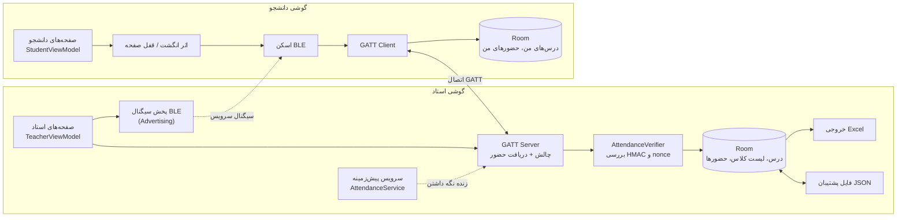
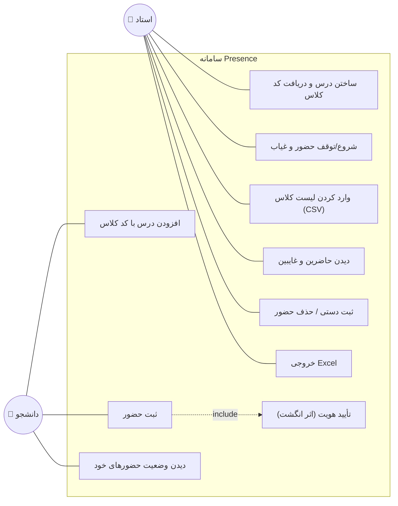
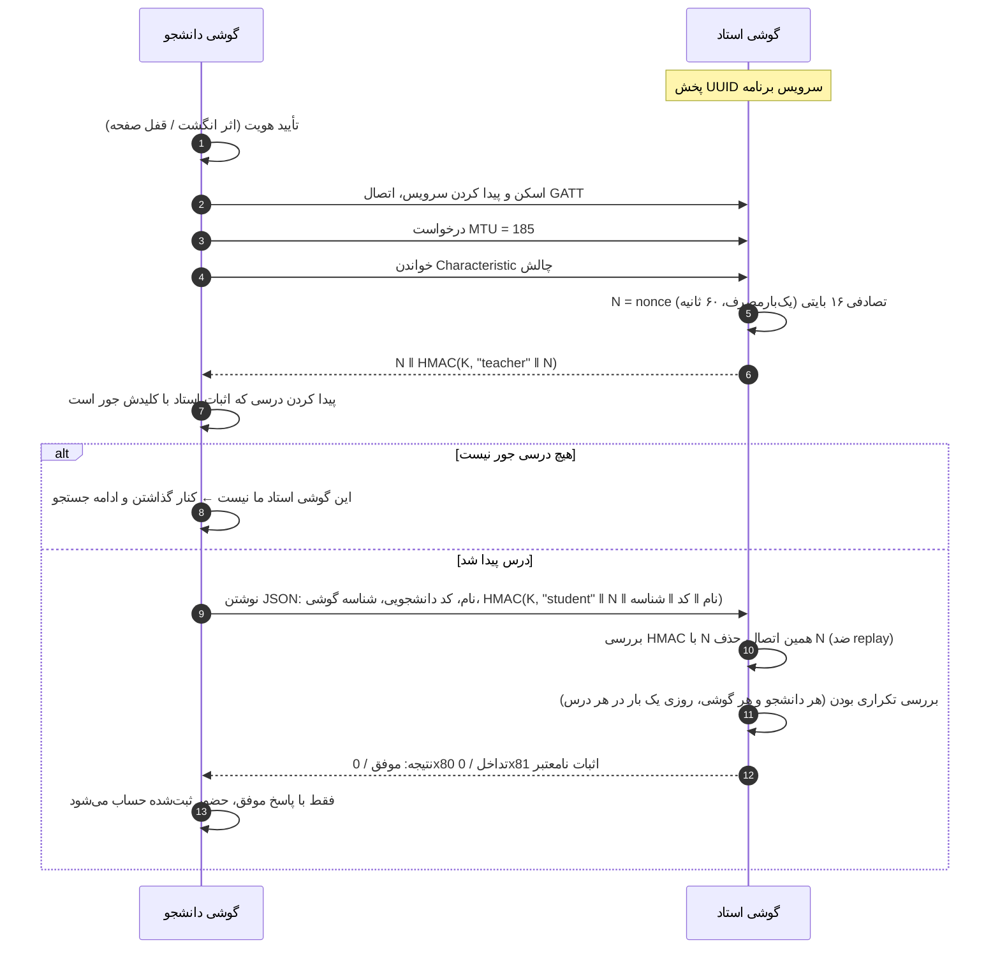
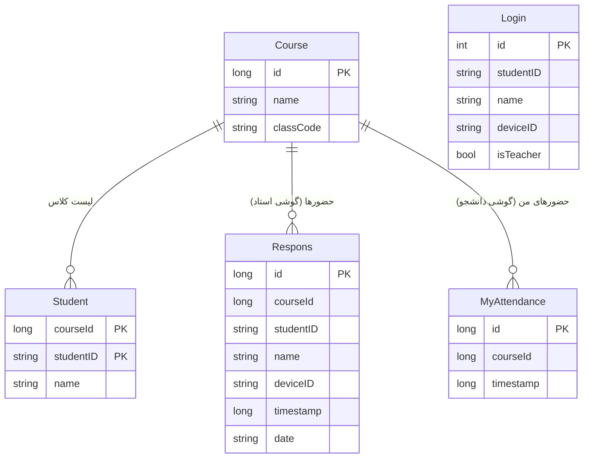

# گزارش پروژه: سامانه حضور و غیاب بدون اینترنت با بلوتوث کم‌مصرف

## ۱. بیان مسئله

حضور و غیاب کاغذی یا شفاهی وقت کلاس را می‌گیرد و جلوی «حاضر زدن به‌جای دیگری» را نمی‌گیرد.
سامانه‌های آنلاین هم به اینترنت و سرور نیاز دارند که در همه کلاس‌ها در دسترس نیست.

هدف این پروژه سامانه‌ای است که:
- **کاملاً بدون اینترنت** کار کند (فقط گوشی استاد و گوشی دانشجوها)؛
- **حضور فیزیکی** دانشجو در کلاس را بسنجد؛
- جلوی **تقلب‌های رایج** را بگیرد؛
- خروجی قابل استفاده برای استاد (Excel) بدهد.

## ۲. انتخاب فناوری: مقایسه روش‌های بدون اینترنت

| روش | نیاز به سخت‌افزار/سرویس | سنجش حضور فیزیکی | تجربه کاربر | محدودیت اصلی |
|---|---|---|---|---|
| **بلوتوث کم‌مصرف (BLE)** ✅ | همه گوشی‌های اندروید ۵ به بعد | برد ۱۰ تا ۳۰ متر ≈ اندازه کلاس | یک دکمه، بدون جفت‌سازی | محدودیت اتصال هم‌زمان GATT |
| Wi-Fi Direct | پشتیبانی گوشی؛ تأیید دستی هر اتصال | برد زیاد (تا ~۱۰۰ متر، بیرون کلاس) | کند و نیازمند تأیید | تجربه کاربری ضعیف برای ۵۰ نفر |
| Google Nearby Connections | Google Play Services | بله (ترکیب بلوتوث و Wi-Fi) | خوب | وابسته به سرویس گوگل؛ روی همه گوشی‌ها نیست |
| QR کد روی صفحه استاد | دوربین | ضعیف؛ عکس QR را می‌شود برای غایب فرستاد | خوب | کپی‌پذیر (مگر چرخشی و ترکیبی) |
| NFC | NFC روی هر دو گوشی | خیلی قوی (چند سانتی‌متر) | باید گوشی‌ها را به هم زد؛ صف طولانی | خیلی از گوشی‌ها NFC ندارند |
| کاغذی | — | ضعیف | کند | امضا به‌جای دیگری |

**نتیجه:** BLE تنها روشی است که هم روی تقریباً همه گوشی‌ها هست، هم به سرویس بیرونی وابسته نیست، هم بردش با اندازه کلاس جور است و هم بدون جفت‌سازی کار می‌کند.
ضعف BLE (قابل جعل بودن سیگنال) با پروتکل چالش-پاسخ رمزنگاری‌شده (بخش ۵) جبران شده است.
QR چرخشی می‌تواند در آینده به‌عنوان عامل دوم اضافه شود.

## ۳. معماری

- **زبان و کتابخانه‌ها:** Kotlin، Android Jetpack (Room، LiveData، Coroutines، Biometric)، Material Components
- **الگوی معماری:** MVVM — صفحه (Fragment) ← ViewModel ← Repository ← DAO ← SQLite.
  بخش بلوتوث در کلاس‌های `AttendanceServer` و `AttendanceClient` جداست. سرور استاد در کل برنامه یک نمونه دارد و
  یک **سرویس پیش‌زمینه** (Foreground Service از نوع connectedDevice) تا وقتی حضور و غیاب روشن است برنامه را زنده نگه می‌دارد؛
  پس با عوض شدن صفحه، چرخش گوشی، قفل شدن صفحه یا رفتن به برنامه دیگر قطع نمی‌شود. اعلان این سرویس تعداد حاضرین امروز و دکمه «توقف» دارد.
- **رابط کاربری:** Material 3، ناوبری پایین (استاد: حضور و غیاب / درس‌ها / گزارش؛ دانشجو: ثبت حضور / درس‌های من)، فونت فارسی شبنم، راست‌به‌چپ کامل
- **بدون کتابخانه بیرونی** برای رمزنگاری (javax.crypto)، تاریخ شمسی و ساخت فایل Excel

## ۴. نمودار موارد کاربرد (Use Case)

## ۵. پروتکل ثبت حضور

### ۵.۱ کد کلاس

برای هر درس، گوشی استاد یک **کد کلاس** ۱۰ نویسه‌ای تصادفی (`SecureRandom`) می‌سازد، مثل `ABCDE-23456`.
الفبای کد ۳۲ نویسه است (بدون O/0 و I/1 که با هم اشتباه می‌شوند)، پس کد حدود **۵۰ بیت** آنتروپی دارد.
استاد کد را یک بار (مثلاً جلسه اول) به دانشجوها می‌دهد. کلید HMAC از روی کد ساخته می‌شود: `K = SHA-256(classCode)`.

### ۵.۲ نمودار توالی

### ۵.۳ جزئیات پیاده‌سازی

| مورد | مقدار |
|---|---|
| UUID سرویس | `6f1c2a4e-8b3d-4c7a-9e51-2d7f0b9a3c11` (اختصاصی، ۱۲۸ بیتی) |
| Characteristic حضور (نوشتن) | `...3c12` |
| Characteristic چالش (خواندن) | `...3c13` |
| الگوریتم | HMAC-SHA256 کوتاه‌شده به ۱۶ بایت؛ هر بخش با طولش وارد HMAC می‌شود |
| اعتبار nonce | ۶۰ ثانیه، یک‌بارمصرف، جدا برای هر دستگاه |
| کدهای خطا | `0x80` تداخل (کد دانشجویی یا گوشی با مشخصات دیگر)، `0x81` اثبات نامعتبر |
| داده‌های بزرگ‌تر از MTU | پشتیبانی از Long Read و Prepared/Execute Write در سمت استاد |

## ۶. پایگاه داده

هر گوشی فقط جدول‌های مربوط به نقش خودش را پر می‌کند.
تغییر ساختار بین نسخه‌ها با **Migration** انجام می‌شود تا داده‌ها پاک نشوند (نسخه ۳ ← ۴ ← ۵).

## ۷. تحلیل امنیت و تهدیدها

| تهدید | راه مقابله | وضعیت |
|---|---|---|
| گوشی جعلی خودش را استاد معرفی کند و حضورها را بدزدد | استاد باید HMAC با کد کلاس را نشان دهد؛ دانشجو بدون آن داده‌ای نمی‌فرستد | ✅ |
| دانشجویی که کد کلاس ندارد حضور ثبت کند | HMAC دانشجو بدون کد کلاس ساخته نمی‌شود | ✅ |
| ضبط پیام یک دانشجو و پخش دوباره (Replay) | nonce یک‌بارمصرف، ۶۰ ثانیه، وابسته به همان اتصال | ✅ |
| تغییر نام/کد دانشجویی در مسیر | همه فیلدها داخل HMAC هستند | ✅ |
| ثبت چند نفر با یک گوشی | هر گوشی (Android ID) روزی یک بار در هر درس | ✅ |
| ثبت یک نفر از چند گوشی | هر کد دانشجویی روزی یک بار در هر درس | ✅ |
| ثبت از بیرون کلاس | برد محدود BLE | ⚠️ نسبی |
| دادن گوشی به دوست حاضر در کلاس | اثر انگشت/قفل صفحه صاحب گوشی | ⚠️ اگر رمز گوشی را بدهد، نه |
| حمله رله (رساندن سیگنال به بیرون با دو دستگاه) | — | ❌ خارج از محدوده |
| حدس زدن کد کلاس (Brute force) | ۵۰ بیت؛ هر حدس نیاز به اتصال BLE دارد | ✅ برای این کاربرد کافی |
| دانشجویی که کد کلاس را دارد خودش را استاد جا بزند | جلوگیری کامل نشده: هم‌کلاسی‌ای که به او وصل شود پیام موفق می‌گیرد ولی در گوشی استاد واقعی ثبت نمی‌شود؛ لیست غایبین استاد این را نشان می‌دهد | ⚠️ بهبود: امضای نامتقارن |

**نکته آخر جدول:** چون کد کلاس بین همه مشترک است، یک دانشجو با کد کلاس می‌تواند در نقش استاد ظاهر شود.
راه‌حل کامل، امضای دیجیتال نامتقارن (مثلاً Ed25519) است: استاد کلید خصوصی دارد و دانشجوها فقط کلید عمومی را؛ در کارهای آینده آمده است.

## ۸. پیاده‌سازی

| بخش | توضیح |
|---|---|
| `AttendanceServer` | سمت استاد: پخش BLE و GATT Server؛ چالش می‌دهد و حضور را بررسی و ذخیره می‌کند |
| `AttendanceService` | سرویس پیش‌زمینه استاد: اعلان «حضور و غیاب در حال اجرا» با تعداد حاضرین و دکمه توقف |
| `AttendanceBackup` / `BackupRepository` | پشتیبان‌گیری همه درس‌ها (با کد کلاس)، لیست‌ها و حضورها در فایل JSON و بازیابی آن در یک تراکنش |
| `AttendanceClient` | سمت دانشجو: اسکن، GATT Client، تشخیص درس با اثبات استاد، ارسال حضور امضاشده |
| `TeacherViewModel` / `StudentViewModel` | داده‌های مشترک صفحه‌ها (درس فعال، حاضرین، غایبین، آمار) |
| `AttendanceStats` | آمار هر درس: جلسه‌ها، درصد حضور، دانشجوهای در خطر حذف |
| صفحه‌ها | ورود، حضور و غیاب، درس‌ها، گزارش (استاد)؛ ثبت حضور، درس‌های من (دانشجو) |
| `AttendanceCrypto` | ساخت کد کلاس، HMAC استاد و دانشجو، مقایسه زمان‌ثابت |
| `AttendanceVerifier` | مدیریت nonceهای یک‌بارمصرف در گوشی استاد |
| `ResponseRepository` | قوانین «یک بار در روز» و تشخیص تداخل، با قفل (Mutex) برای درخواست‌های هم‌زمان |
| `RosterParser` | خواندن CSV با تشخیص کدگذاری (UTF-8 / Windows-1256)، جداکننده و ترتیب ستون‌ها |
| `XlsxWriter` | ساخت فایل `.xlsx` استاندارد (Office Open XML) بدون کتابخانه |
| `PersianDate` | تبدیل میلادی به شمسی (الگوریتم چرخه ۳۳ ساله)، اعداد فارسی |

## ۹. آزمون‌ها

### ۹.۱ تست‌های خودکار (اجرا روی کامپیوتر)

| کلاس تست | موضوع |
|---|---|
| `AttendanceCryptoTest` | کد کلاس، درستی و نادرستی HMAC، جابه‌جا نشدن مرز فیلدها |
| `AttendanceVerifierTest` | پذیرش پاسخ درست؛ رد replay، nonce منقضی، کد اشتباه، nonce دستگاه دیگر |
| `PersianDateTest` | تبدیل تاریخ‌های شناخته‌شده (۲۲ بهمن ۱۳۵۷، نوروز ۱۴۰۳ و ۱۴۰۴، اسفند کبیسه) |
| `RosterParserTest` | سطر عنوان، ستون ردیف، اعداد فارسی، جداکننده‌های مختلف، Windows-1256 |
| `XlsxWriterTest` | ساختار فایل xlsx، escape کردن XML، نام ستون‌ها (A…Z، AA) |
| `AttendanceExporterTest` | جدول دانشجو × جلسه، شمارش غیبت، هشدار ۳/۱۶، دانشجوی خارج از لیست |
| `AttendanceBackupTest` | ساخت و خواندن فایل پشتیبان، رد فایل نامعتبر، جایگزینی کامل دیتابیس |
| `MigrationTest` | انتقال داده‌های نسخه ۴ دیتابیس به نسخه ۵ (با Robolectric) |

اجرا: `./gradlew testDebugUnitTest`

### ۹.۲ آزمون میدانی (با گوشی واقعی) — برای تکمیل

| آزمون | روش | نتیجه |
|---|---|---|
| برد مؤثر | فاصله دانشجو از استاد را ۱، ۵، ۱۰، ۲۰، ۳۰ متر کنید | |
| زمان ثبت هر نفر | از زدن دکمه تا پیام موفق (میانگین ۱۰ بار) | |
| ثبت هم‌زمان | ۵، ۱۰، ۲۰ گوشی با هم دکمه را بزنند؛ تعداد موفق در ۳۰ ثانیه | |
| نسخه‌های اندروید | اندروید ۱۰، ۱۲، ۱۳ و ۱۴ به بعد (مسیرهای کد جدا دارند) | |
| دو کلاس کنار هم | دو استاد با کد متفاوت؛ هر دانشجو باید در کلاس خودش ثبت شود | |
| کد اشتباه | دانشجو با کد کلاس اشتباه؛ باید «استاد کلاس شما نیست» ببیند | |
| ثبت تکراری | دانشجو دو بار در یک روز؛ بار دوم «قبلاً ثبت شده» | |
| خروجی Excel | باز کردن فایل در Excel، Google Sheets و LibreOffice | |
| پس‌زمینه | حضور و غیاب را روشن کنید، صفحه را قفل کنید و ۱۰ دقیقه بعد دانشجو ثبت کند | |
| پشتیبان | پشتیبان از گوشی ۱، بازیابی روی گوشی ۲؛ دانشجوها بدون تغییر در گوشی ۲ ثبت شوند | |

## ۱۰. محدودیت‌ها و کارهای آینده

- **امضای نامتقارن** برای گوشی استاد (جلوگیری از استاد جعلی توسط هم‌کلاسی‌ها)
- **QR چرخشی** به‌عنوان عامل دوم سنجش حضور
- همگام‌سازی اختیاری با سرور دانشگاه وقتی اینترنت هست (معماری Offline-first)
- وارد کردن مستقیم فایل `.xlsx` (الان باید CSV ذخیره شود)
- تزریق وابستگی (Hilt) به‌جای ساختن Repositoryها در ViewModel
- اندازه‌گیری فاصله با RSSI برای محدود کردن دقیق‌تر به داخل کلاس

## ۱۱. منابع

- Bluetooth SIG, *Bluetooth Core Specification* — بخش‌های GAP، ATT و GATT
- Android Developers, *Bluetooth Low Energy overview* — developer.android.com/develop/connectivity/bluetooth/ble
- H. Krawczyk et al., *RFC 2104: HMAC — Keyed-Hashing for Message Authentication*, 1997
- ECMA-376, *Office Open XML File Formats* (ساختار فایل xlsx)
- Android Developers, *Room persistence library* و *Migrating Room databases*
